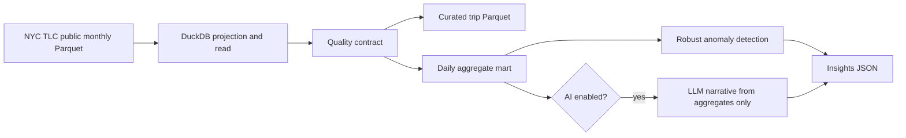

# Architecture

## Data flow

## Boundaries

- `pipeline.py` coordinates I/O and stages. Transformations stay in small modules that can be reasoned about independently.
- DuckDB reads only the columns needed for the output and performs daily aggregation in-process.
- Quality checks run before any curated output is written. Rejected and duplicate row counts are captured in run metadata.
- The statistical anomaly detector is deterministic and runs without network access.
- The AI layer is optional and receives daily aggregate rows plus anomaly findings. Raw trips and location identifiers are not sent to the model.

## Outputs

Each run writes curated trips, a daily mart, an insights document, and metadata under the configured output directory. Outputs are period-scoped, so processing a later month does not overwrite earlier monthly artifacts.

## Operational path

The CLI is the first executable interface. The planned orchestration step will wrap the same `run` function in a scheduled Airflow or Dagster job; orchestration should not duplicate transformation rules.
